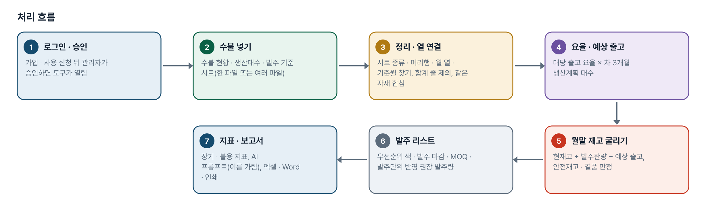
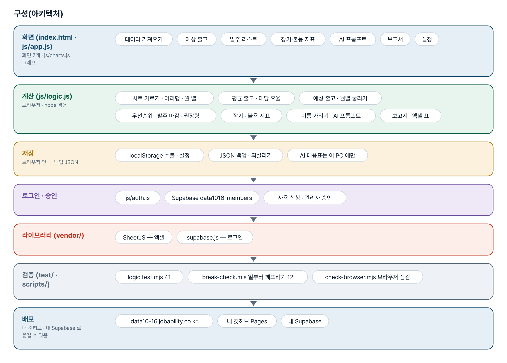
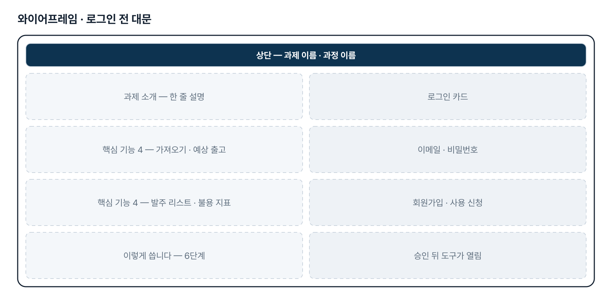
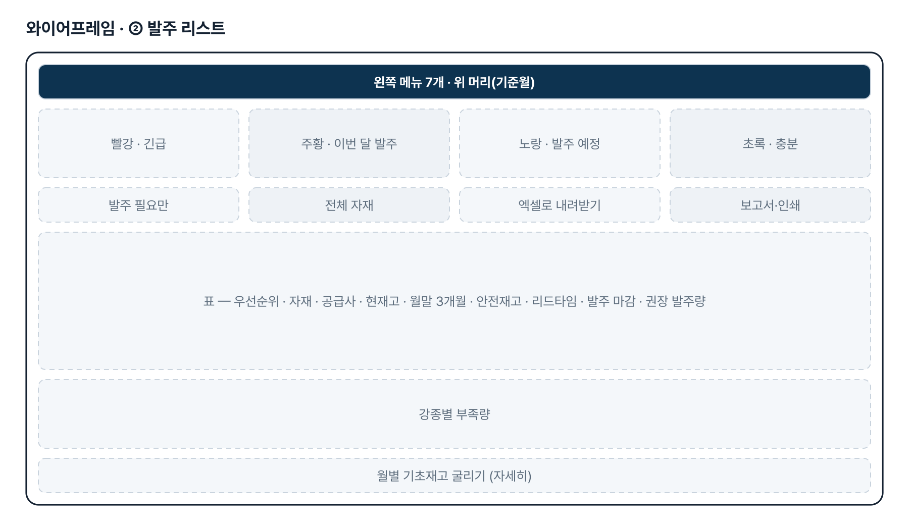
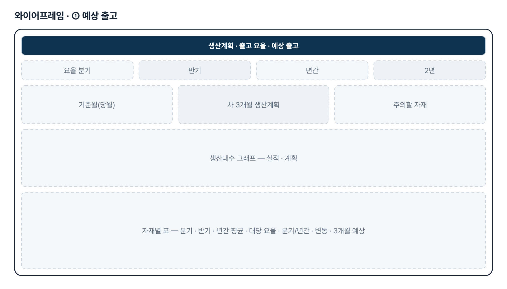
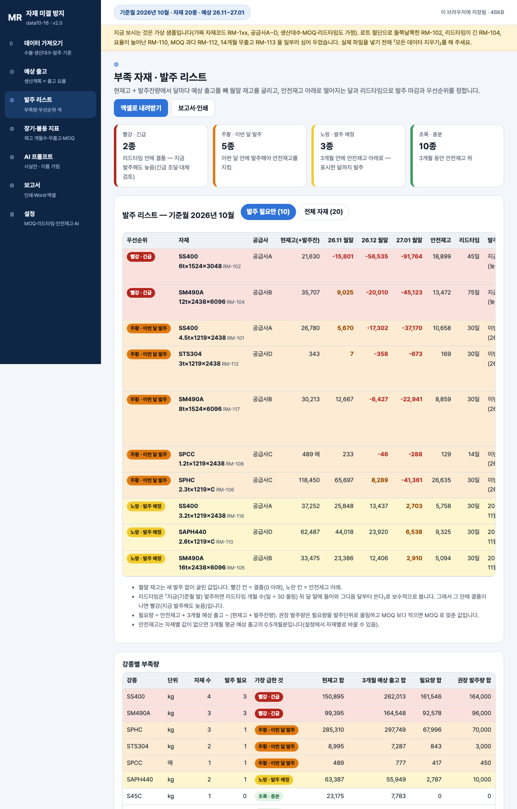

# 원/부자재 미결 방지 사전 관리 — 프로젝트 기획서 v2.0

- 기획: 이성헌 · 작성일 2026-11-10 · 현장 데이터 디지털화 전문가과정 · 2차수 프로젝트 16
- 바로 쓰기: https://data10-16.jobability.co.kr/
- 워드 판: `docs/기획서/data10-16_이성헌_원부자재미결방지사전관리_기획서_v2.0.docx`

## 개요

입출고 수불 엑셀과 생산계획으로 자재(강종·규격)별 대당 출고 요율과 차 3개월 예상 출고·월말 재고를 굴려, MOQ·리드타임을 반영한 색 구분 발주 리스트와 장기·불용 재고 지표를 만드는 브라우저 도구입니다.

### 배경 · 현재 업무
- 원/부자재는 이론적으로 자재 원단위 기준 MRP 로 수급하면 되지만, 특정 규격 자재가 미결(결품)되는 일이 종종 생깁니다.
- 규격이 많은 자재 종수(강종 × 두께·폭)와, 생산에서 lot 단위로 절단해 한 규격의 출고가 한 번에 몰려 나가는 것이 원인으로 적혀 있습니다.
- 지금은 입출고 수불 엑셀(현재고 · 당월 입출고 · 직전 1~24개월 출고 · 평균 출고 · 생산대수 대비 출고 요율)로 손으로 계산합니다.
- 엑셀 기반 업무를 자동 · 디지털화해 부족 자재 발주 리스트를 늘 같은 기준으로 만들고 싶어 합니다.

### 목표
- 수불 엑셀을 넣으면 규격별 차 3개월 예상 출고 → 월별 기초재고 → 부족량 → 발주 리스트가 같은 기준으로 나옵니다.
- 발주 우선순위를 색(빨강 긴급 · 주황 이번 달 · 노랑 예정 · 초록 충분)으로 나눠 이번 달 무엇부터 발주할지 바로 보입니다.
- MOQ · 리드타임 · 발주단위 · 안전재고를 자재마다 반영해 발주 마감과 권장 발주량을 냅니다.
- 재고 개월수 · 무출고 · 출고 감소 · MOQ 과다로 장기 · 불용 재고 위험도 함께 봅니다.

## 요구사항과 구현

| 기획서 요구 | 구현 |
|---|---|
| 입출고 수불(excel) 파일 기반 | 수불 현황 · 생산대수 · 발주 기준 시트 자동 가름, 머리행 · 월 열(「2026-09」「M-1」 등) · 기준월 찾기, 열 연결 확인, 합계 줄 제외 |
| 생산대수 대비 규격별 자재 투입 요율 | 대당 요율 = 직전 N개월 출고 합 ÷ 같은 달 생산실적 대수 합(분기 · 반기 · 년간 · 2년 단추), 「분기/년간」 요율 변화 표시 |
| 차 3개월 생산대수 기반 예상 출고량 | 대당 요율 × 차 3개월 생산계획 대수, 계획이 없는 달은 직전 평균 실적 대수 |
| 월별 기초재고를 감안한 부족 강재량 | 현재고 + 발주잔량에서 달마다 굴린 월말 재고, 안전재고 대비 부족량 · 결품 표시, 강종별 부족량(단위가 같은 것끼리) |
| 발주 우선순위 색상 구분 | 빨강 긴급 · 주황 이번 달 발주 · 노랑 발주 예정 · 초록 충분 + 발주 마감 |
| MOQ · Lead time 을 감안한 발주 시점 | 자재별 MOQ · 리드타임 · 발주단위 · 안전재고(설정 · 발주 기준 시트), 권장 발주량 = 필요량을 발주단위로 올림 · MOQ 맞춤 |
| 장기 재고 등 불용재 사전 방지 지표 | 재고 개월수 · 마지막 출고 · 출고 감소 · MOQ 과다 · 재고 금액(단가가 있으면). 기준값은 임시 |
| lot 단위 절단으로 특정 규격 미결 | 월별 출고 변동계수로 「들쭉날쭉」 자재를 찾아 안전재고 상향을 권함. 절단 계획 직접 반영은 2단계 |

## 주요 기능

- **수불 엑셀 가져오기** — 수불 현황 · 생산대수 · 발주 기준 시트를 알아서 가르고, 머리행 · 월 열 · 기준월을 찾아 열을 연결합니다.
- **차 3개월 예상 출고** — 직전 출고와 생산실적 대수로 대당 요율을 내고, 차 3개월 생산계획을 곱해 달마다 예상 출고를 냅니다.
- **색 구분 발주 리스트** — 월말 재고를 굴려 빨강 · 주황 · 노랑 · 초록 우선순위, 발주 마감, MOQ 를 반영한 권장 발주량을 냅니다.
- **장기 · 불용 지표** — 재고 개월수 · 마지막 출고 · 출고 감소 · MOQ 과다로 미결 반대쪽 위험인 장기 · 불용 재고를 미리 봅니다.
- **AI 프롬프트** — 계산된 사실만 담고 공급사 · 자재코드는 「공급사1」「자재2」 같은 별칭으로 가립니다. AI 답은 원래 이름으로 되돌립니다.
- **보고서** — 총괄 · 계산 기준 · 발주 리스트 · 강종별 부족량 · 장기 · 불용 · AI 의견 — 인쇄/PDF · Word · 엑셀 · 글자 복사.
- **설정 · 백업** — 요율 기간 · 안전재고 · 리드타임 · MOQ · 발주단위 기본값과 자재별 값, 차 3개월 생산계획, AI 연결, JSON 백업.
- **로그인 · 사용 승인** — 회사 메일이나 개인 메일로 가입하고 사용 신청 → 관리자 승인 뒤 씁니다.

## 처리 흐름(파이프라인)

1. **로그인 · 승인** — 가입 · 사용 신청 뒤 관리자가 승인하면 도구가 열림
2. **수불 넣기** — 수불 현황 · 생산대수 · 발주 기준 시트(한 파일 또는 여러 파일)
3. **정리 · 열 연결** — 시트 종류 · 머리행 · 월 열 · 기준월 찾기, 합계 줄 제외, 같은 자재 합침
4. **요율 · 예상 출고** — 대당 출고 요율 × 차 3개월 생산계획 대수
5. **월말 재고 굴리기** — 현재고 + 발주잔량 − 예상 출고, 안전재고 · 결품 판정
6. **발주 리스트** — 우선순위 색 · 발주 마감 · MOQ · 발주단위 반영 권장 발주량
7. **지표 · 보고서** — 장기 · 불용 지표, AI 프롬프트(이름 가림), 엑셀 · Word · 인쇄

## 구성(아키텍처)

- **화면 (index.html · js/app.js)** — 데이터 가져오기 · 예상 출고 · 발주 리스트 · 장기·불용 지표 · AI 프롬프트 · 보고서 · 설정
- **계산 (js/logic.js)** — 시트 가르기 · 머리행 · 월 열 · 평균 출고 · 대당 요율 · 예상 출고 · 월별 굴리기 · 우선순위 · 발주 마감 · 권장량 · 장기 · 불용 지표 · 이름 가리기 · AI 프롬프트 · 보고서 · 엑셀 표
- **저장** — localStorage 수불 · 설정 · JSON 백업 · 되살리기 · AI 대응표는 이 PC 에만
- **로그인 · 승인** — js/auth.js · Supabase data1016_members · 사용 신청 · 관리자 승인
- **라이브러리 (vendor/)** — SheetJS — 엑셀 · supabase.js — 로그인
- **검증 (test/ · scripts/)** — logic.test.mjs 41 · break-check.mjs 일부러 깨뜨리기 12 · check-browser.mjs 브라우저 점검
- **배포** — data10-16.jobability.co.kr · 내 깃허브 Pages · 내 Supabase

## 화면 구성(와이어프레임)

## 규칙 · 판정 기준

- 대당 요율 = 직전 N개월 출고 합 ÷ 같은 달 생산실적 대수 합(대수 가중, 월별 요율의 평균이 아님). 평균 · 요율에서 당월은 뺍니다. 기본 기간은 반기(6개월).
- 예상 출고 = 대당 요율 × 그 달 생산계획 대수. 계획이 없는 달은 직전 평균 실적 대수로 봅니다.
- 리드타임은 보수적으로 — 지금(기준월 말) 발주하면 리드타임 개월 수(일 ÷ 30 올림) 뒤 달 말에 들어와 그다음 달부터 씁니다.
- 우선순위: 빨강 = 리드타임 안 결품(지금 발주해도 늦음) · 주황 = 이번 달 발주해야 안전재고 유지 · 노랑 = 3개월 안에 안전재고 아래 · 초록 = 3개월 동안 안전재고 위.
- 필요량 = 안전재고 + 3개월 예상 출고 − (현재고 + 발주잔량). 권장 발주량은 필요량을 발주단위로 올림하고 MOQ 보다 작으면 MOQ.
- MOQ 과다는 MOQ 때문에 3개월 뒤에도 장기재고 기준(6개월분) 이상 남을 때만 붙입니다.
- 같은 자재가 두 줄이면 더하고 알립니다. 강종별 부족량은 단위가 같은 것끼리만 더합니다.
- 안전재고 0.5개월분 · 리드타임 30일 · 불용 12개월 · 장기 6개월은 임시 기본값입니다. 자재별 값은 설정 화면 > 발주 기준 시트 > 수불 시트 칸 > 기본값 순서로 씁니다.

## 검증

- 계산 규칙 테스트 41개 통과
- 일부러 깨뜨려 확인 scripts/break-check.mjs 12가지(요율을 월별 평균으로, MOQ 미반영, 발주단위 반올림, 공급사 안 가림 등) — 모두 검사가 실패하는 것을 보고 원복했습니다.
- 처음엔 발주단위 올림 · 반올림이 같은 값이 되는 표(120 ÷ 40)로 검사해 「반올림」 깨뜨리기를 못 잡았고, 50 단위 검사를 더해 잡히게 했습니다.
- 브라우저 점검 scripts/check-browser.mjs 는 10-27 판 맞추기 점검 때 결과입니다(이번 판에서 다시 돌리지 않음).

## 이번 판에서 하지 않는 것

- 업무 자료는 아직 팀 공유 DB 가 아니라 각자의 브라우저(localStorage)에 저장합니다. 구매 · 생산관리가 같은 데이터를 함께 보지 못합니다.
- 실제 수불 엑셀 · 생산계획 · MOQ · 리드타임 표를 아직 받지 않아, 샘플은 제출 글의 항목대로 만든 가상 값입니다.
- 안전재고 · 리드타임 · 장기 · 불용 기준은 임시 기본값입니다.
- lot 절단 계획 · 대체 규격은 직접 반영하지 않습니다(출고 변동으로 알림만).
- 발주서 양식 출력 · ERP 연동은 하지 않습니다(엑셀 내보내기).

## 다음 단계

- 실제 수불 · 생산계획 견본으로 열 연결 · 기준월 · 단위 · 발주잔량 입고 예정월 맞추기
- 팀 공유 저장 — 수불 · 기준값을 Supabase 에 두고 승인된 팀원이 함께 보기
- 발주서 양식 출력, lot 절단 계획 · 대체 규격 묶음
- 발주 뒤 실제와 비교해 요율 · 안전재고 다시 맞추기

## 버전 이력

- **v2.0** (2026-11-10) — 최종 기획서 — 파이프라인 · 아키텍처 · 와이어프레임 정리 / 로그인 · 사용 신청 · 관리자 승인(요청자 Supabase 로 옮길 수 있게) / 로그인 전 대문
- **v1.1** (2026-10-27) — 버튼 · 결과 불일치 점검 — 요율 2년(24개월) 단추 / 가져온 때 · 백업 파일 이름을 이 PC 시각으로 / 판 맞추기(?v= · fresh-guard)
- **v1.0** (2026-10-27) — 1단계 — 가져오기 · 예상 출고 · 발주 리스트 · 장기·불용 지표 · AI 프롬프트 · 보고서 · 설정
